# Dominó Ponta de Quina — Cliente da API (Checkpoint 6)

Cliente em **C# / .NET 8** para jogar partidas completas de **Dominó Ponta de Quina** pela API da disciplina.
A interface é um app **Blazor Server** que lembra uma mesa de jogo: pedras, mão própria, placar, turno, relógio
e as ações permitidas. O cliente também tem um **jogador autônomo**, que joga sozinho quando chega a vez.

> A API decide tudo (distribuição, jogador inicial, validade das jogadas, pontuação e vencedor).
> O cliente só mostra o estado confirmado, envia comandos e explica as rejeições, **sem fingir que uma ação rejeitada deu certo**.

## Integrantes

| Nome | RM |
|------|----|
|      |    |

## Sumário

- [Requisitos](#requisitos)
- [Como executar](#como-executar)
- [Como jogar](#como-jogar)
- [Arquitetura](#arquitetura)
- [Diagrama de classes](#diagrama-de-classes)
- [Contrato da API usado](#contrato-da-api-usado)
- [Tratamento de erros](#tratamento-de-erros)
- [Jogador autônomo](#jogador-autônomo)
- [Testes automatizados](#testes-automatizados)
- [Decisões e observações](#decisões-e-observações)

## Requisitos

- [.NET SDK 8](https://dotnet.microsoft.com/download/dotnet/8.0) (`dotnet --version` deve mostrar 8.x)
- Um e-mail FIAP (`@fiap.com.br`) para receber o token da API

## Como executar

```bash
dotnet restore
dotnet run --project src/DominoQuina.Web
```

O navegador abre em **http://localhost:5080**.

### Configuração

O endereço da API fica em `src/DominoQuina.Web/appsettings.json`:

```json
"DominoApi": {
  "BaseUrl": "https://domino-quina-atbkg6ckcwbpd5gz.westus3-01.azurewebsites.net/",
  "TimeoutSegundos": 20,
  "IntervaloAtualizacaoMs": 1500
}
```

Também é possível sobrescrever pela linha de comando:

```bash
dotnet run --project src/DominoQuina.Web -- --DominoApi:BaseUrl=https://outro-endereco/
```

### Dois clientes na mesma máquina

Para testar uma partida sozinho, rode uma segunda instância em outra porta e com outro arquivo de credenciais.
Cada instância funciona como um cliente diferente, com chaves de ativação próprias.

```bash
dotnet run --project src/DominoQuina.Web --no-launch-profile -- --environment Development --urls http://localhost:5081 --Credenciais:Arquivo=credenciais-2.dat
```

Documentação da API: [Swagger](https://domino-quina-atbkg6ckcwbpd5gz.westus3-01.azurewebsites.net/swagger) ·
[OpenAPI](https://domino-quina-atbkg6ckcwbpd5gz.westus3-01.azurewebsites.net/swagger/v1/swagger.json)

## Como jogar

1. **Conta** (`/`): informe o e-mail FIAP e clique em *Solicitar token*. A API responde `202 Accepted` e envia o token
   por e-mail. Cole o token e clique em *Salvar e continuar*. O token fica guardado e é reutilizado até ser revogado.
2. **Perfis** (`/perfis`): escolha (ou digite o ID de) um jogador-perfil e clique em *Ativar e jogar*.
   O cliente gera uma chave aleatória de 64 caracteres hexadecimais, guarda-a protegida e ativa o perfil.
   *Liberar perfil* chama `desativar-cliente` para que outro cliente possa usá-lo.
3. **Partidas** (`/jogador/{id}/partidas`): crie uma mesa (alvo de 50, 100 ou 150 pontos) ou entre em uma mesa com vaga.
4. **Mesa** (`/jogador/{id}/partidas/{partidaId}`):
   - com dois jogadores, clique em *Iniciar partida*;
   - na sua vez, clique numa pedra destacada da mão. Se ela encaixa nas duas pontas, escolha *◀ Esquerda* ou *Direita ▶*
     (o botão mostra os pontos que a jogada faz);
   - sem encaixe, use *Comprar*; *Passar* só fica habilitado quando o estado indica;
   - marque *Jogador autônomo* para o cliente jogar sozinho;
   - o relógio mostra o tempo no turno e o **desconto previsto pela regra futura de demora** (slide 14);
   - ao final, aparece o resultado com o placar oficial.

## Arquitetura

```
DominoQuina.sln
├── src/
│   ├── DominoQuina.Core/          # Regras do cliente, sem dependência de interface
│   │   ├── Api/                   # Cliente HTTP, rotas, comandos, mapeamento de respostas e erros
│   │   ├── Modelos/               # Pedra, EstadoPartida, ResumoPartida, enums
│   │   ├── Jogo/                  # SessaoPartida, RegrasMesa, estratégia e jogador autônomo
│   │   └── Seguranca/             # Token, chave de ativação e armazenamento protegido
│   └── DominoQuina.Web/           # Interface Blazor Server (páginas, componentes e CSS da mesa)
└── tests/
    └── DominoQuina.Tests/         # Testes xUnit do Core
```

| Camada | Responsabilidade |
|--------|------------------|
| `DominoApiClient` | Envia as requisições com `Authorization: Bearer` e `X-Jogador-Ativacao` e converte rejeições em `ApiException`. |
| `MapeadorRespostas` / `LeitorJson` | Converte o JSON da API em `EstadoPartida`, aceitando variações de nome dos campos. |
| `SessaoPartida` | Guarda o último estado confirmado, aplica **somente versões mais novas**, envia comandos com `versaoEsperada` e chave de idempotência e mede o tempo no turno. |
| `RegrasMesa` | Encaixe, jogadas válidas, pontos (soma das pontas múltipla de 5 ÷ 5) e orientação da cadeia para desenhar a mesa. |
| `EstrategiaPontaDeQuina` / `JogadorAutonomo` | Decidem e executam a jogada automática. |
| `GerenciadorAtivacao` / `ArmazenamentoCredenciaisEmArquivo` | Ativam e liberam perfis e guardam token e chaves criptografados (ASP.NET Data Protection). |
| Páginas Blazor | `Entrar`, `Perfis`, `Partidas` e `Mesa`, com os componentes `PedraDomino` e `AlertaErro`. |

## Diagrama de classes

```mermaid
classDiagram
    direction LR

    class IDominoApiClient {
        <<interface>>
        +SolicitarTokenAsync(email)
        +AtivarClienteAsync(jogadorId, chave)
        +DesativarClienteAsync(jogadorId)
        +ListarPartidasAsync(jogadorId) List~ResumoPartida~
        +CriarPartidaAsync(jogadorId, alvo) string
        +EntrarPartidaAsync(partidaId, jogadorId)
        +IniciarPartidaAsync(partidaId, ComandoTurno) EstadoPartida
        +ObterEstadoAsync(partidaId, jogadorId) EstadoPartida
        +ObterAtualizacoesAsync(partidaId, jogadorId, versao) EstadoPartida
        +JogarAsync(partidaId, ComandoJogada) EstadoPartida
        +ComprarAsync(partidaId, ComandoTurno) EstadoPartida
        +PassarAsync(partidaId, ComandoTurno) EstadoPartida
        +ObterResultadoAsync(partidaId, jogadorId) ResultadoPartida
    }
    class DominoApiClient {
        -HttpClient http
        -IProvedorCredenciais credenciais
    }
    class MapeadorRespostas {
        <<static>>
        +MapearEstado(json, jogadorId) EstadoPartida
        +MapearPartidas(json, jogadorId) List~ResumoPartida~
        +MapearResultado(json, jogadorId) ResultadoPartida
    }
    class ApiException {
        +HttpStatusCode StatusCode
        +string Codigo
        +string MensagemServidor
        +TimeSpan AguardarPor
        +bool ConflitoDeVersao
        +bool PerfilAtivoEmOutroCliente
        +string Orientacao
    }
    class ComandoJogada {
        <<record>>
        +string JogadorId
        +long VersaoEsperada
        +Guid ChaveIdempotencia
        +int ValorA
        +int ValorB
        +LadoMesa Lado
    }
    class ComandoTurno {
        <<record>>
        +string JogadorId
        +long VersaoEsperada
        +Guid ChaveIdempotencia
    }

    class Pedra {
        <<record struct>>
        +int ValorA
        +int ValorB
        +bool EhDupla
        +Encaixa(ponta) bool
        +ValorExposto(ponta) int
    }
    class EstadoPartida {
        <<record>>
        +long Versao
        +int Rodada
        +ProximaAcao ProximaAcao
        +List~Pedra~ MinhaMao
        +List~Pedra~ Mesa
        +int PontaEsquerda
        +int PontaDireita
        +Pedra PedraAbertura
        +int PedrasAdversario
        +List~PontuacaoJogador~ Placar
        +bool MinhaVez
        +bool Encerrada
    }
    class ProximaAcao {
        <<enum>>
        Aguardar
        JogarAbertura
        Jogar
        Comprar
        Passar
        Encerrar
    }
    class LadoMesa {
        <<enum>>
        Esquerda = 0
        Direita = 1
    }

    class SessaoPartida {
        +EstadoPartida Estado
        +TimeSpan TempoNoTurno
        +int DescontoPrevisto
        +CarregarAsync()
        +SincronizarAsync() bool
        +Aplicar(EstadoPartida) bool
        +JogarAsync(Pedra, LadoMesa) ResultadoAcao
        +ComprarAsync() ResultadoAcao
        +PassarAsync() ResultadoAcao
        +IniciarAsync() ResultadoAcao
    }
    class ResultadoAcao {
        <<record>>
        +bool Sucesso
        +string Mensagem
        +ApiException Erro
    }
    class RegrasMesa {
        <<static>>
        +PontosPorSoma(soma) int
        +JogadasValidas(EstadoPartida) List~JogadaPossivel~
        +OrientarCadeia(pedras) List~Pedra~
    }
    class PenalidadeDemora {
        <<static>>
        +CalcularDesconto(tempo) int
    }
    class IEstrategiaJogo {
        <<interface>>
        +Decidir(EstadoPartida) Decisao
    }
    class EstrategiaPontaDeQuina
    class Decisao {
        <<record>>
        +TipoDecisao Tipo
        +Pedra Pedra
        +LadoMesa Lado
        +string Motivo
    }
    class JogadorAutonomo {
        +Decisao UltimaDecisao
        +JogarVezAsync(SessaoPartida) ResultadoAcao
    }

    class IProvedorCredenciais {
        <<interface>>
        +string Token
        +ObterChaveAtivacao(jogadorId) string
    }
    class IArmazenamentoCredenciais {
        <<interface>>
        +SalvarToken(email, token)
        +ObterOuCriarChaveAtivacao(jogadorId) string
        +RemoverChaveAtivacao(jogadorId)
    }
    class ArmazenamentoCredenciaisEmArquivo
    class IProtetorDados {
        <<interface>>
        +Proteger(texto) string
        +Desproteger(texto) string
    }
    class GeradorChaveAtivacao {
        <<static>>
        +Gerar() string
    }
    class GerenciadorAtivacao {
        +AtivarAsync(jogadorId)
        +LiberarAsync(jogadorId)
    }

    IDominoApiClient <|.. DominoApiClient
    DominoApiClient --> IProvedorCredenciais
    DominoApiClient ..> MapeadorRespostas
    DominoApiClient ..> ApiException : lança
    DominoApiClient ..> ComandoJogada
    DominoApiClient ..> ComandoTurno
    MapeadorRespostas ..> EstadoPartida : cria
    EstadoPartida *-- Pedra
    EstadoPartida --> ProximaAcao
    ComandoJogada --> LadoMesa

    SessaoPartida --> IDominoApiClient
    SessaoPartida --> EstadoPartida : último confirmado
    SessaoPartida ..> ResultadoAcao
    SessaoPartida ..> PenalidadeDemora
    ResultadoAcao --> ApiException

    IEstrategiaJogo <|.. EstrategiaPontaDeQuina
    EstrategiaPontaDeQuina ..> RegrasMesa
    EstrategiaPontaDeQuina ..> Decisao
    JogadorAutonomo --> IEstrategiaJogo
    JogadorAutonomo ..> SessaoPartida : envia ações

    IProvedorCredenciais <|-- IArmazenamentoCredenciais
    IArmazenamentoCredenciais <|.. ArmazenamentoCredenciaisEmArquivo
    ArmazenamentoCredenciaisEmArquivo --> IProtetorDados
    ArmazenamentoCredenciaisEmArquivo ..> GeradorChaveAtivacao
    GerenciadorAtivacao --> IDominoApiClient
    GerenciadorAtivacao --> IArmazenamentoCredenciais
```



## Contrato da API usado

| Ação | Requisição | Cabeçalhos |
|------|------------|------------|
| Solicitar token | `POST /api/identidade/token` `{ "email" }` → **202** (token chega por e-mail) | — |
| Ativar perfil | `POST /api/jogadores/{jogadorId}/ativar-cliente` `{ "chaveAtivacao" }` | Bearer |
| Liberar perfil | `DELETE /api/jogadores/{jogadorId}/desativar-cliente` | Bearer + `X-Jogador-Ativacao` |
| Listar partidas | `GET /api/partidas` | Bearer + ativação |
| Criar mesa | `POST /api/partidas` `{ "pontuacaoAlvo", "jogadorId" }` | Bearer + ativação |
| Entrar na mesa | `POST /api/partidas/{id}/entrar` `{ "jogadorId" }` | Bearer + ativação |
| Iniciar | `POST /api/partidas/{id}/iniciar` | Bearer + ativação |
| Estado | `GET /api/partidas/{id}?jogadorId=` | Bearer + ativação |
| Atualizações | `GET /api/partidas/{id}/atualizacoes?jogadorId=&versaoConhecida=` → **200** estado novo / **204** nada mudou | Bearer + ativação |
| Jogar | `POST /api/partidas/{id}/jogar` `{ jogadorId, versaoEsperada, chaveIdempotencia, valorA, valorB, lado }` | Bearer + ativação |
| Comprar / Passar | `POST /api/partidas/{id}/comprar` · `/passar` `{ jogadorId, versaoEsperada, chaveIdempotencia }` | Bearer + ativação |
| Resultado | `GET /api/partidas/{id}/resultado?jogadorId=` | Bearer + ativação |

`lado = 0` é a ponta esquerda e `lado = 1` a direita. Todas as rotas estão centralizadas em `Core/Api/Rotas.cs`.

## Tratamento de erros

| HTTP | O que o cliente faz |
|------|---------------------|
| 401 | Mostra que o token está ausente, inválido ou revogado e oferece o link para informar um novo. |
| 403 | Informa que o usuário ou o perfil não tem permissão para a ação. |
| 409 `JOGADOR_JA_ATIVO` | Explica que o perfil está ativo em outro cliente e precisa ser liberado lá. A chave local é mantida. |
| 409 (versão) | Recarrega o **estado autoritativo** da partida e pede para o jogador revisar a jogada. |
| 422 | Mostra a rejeição (jogada, encaixe, turno ou passagem inválida) e avisa que a partida **não avançou**. |
| 429 | Lê o `Retry-After` e informa quanto tempo esperar antes de pedir o token de novo. |
| Rede / timeout | Reenvia a **mesma intenção com a mesma chave de idempotência** (até 3 tentativas). Se continuar sem resposta, recarrega a mesa e avisa que a ação pode não ter sido registrada. |

Toda rejeição aparece com o código HTTP, o código de negócio, a orientação e a mensagem do servidor (componente `AlertaErro`).

## Jogador autônomo

Ative o interruptor **Jogador autônomo** na mesa. A cada atualização, se o estado confirmado indicar a vez do perfil,
o `JogadorAutonomo` pede uma decisão à `EstrategiaPontaDeQuina` e envia a ação pela `SessaoPartida`
(mesmo caminho da jogada manual, com versão e idempotência).

Estratégia (gulosa, específica da Ponta de Quina):

1. **Abertura**: joga a pedra obrigatória indicada pela API.
2. **Jogada que mais pontua agora**: simula cada pedra em cada ponta e escolhe a que deixa a soma das pontas
   múltipla de 5 com o maior valor.
3. **Desempate**: prefere duplas (difíceis de encaixar depois) e, em seguida, a pedra de maior soma
   (reduz os pontos que sobram na mão se a mesa travar).
4. Sem encaixe: **compra** se o estado permitir; senão, **passa** (só quando o estado indicar).

O autônomo age cerca de 1,2 s depois de receber o turno, dentro da faixa sem desconto (até 10 s). Depois de uma
rejeição, espera 3 s e decide de novo com o estado recarregado.

## Testes automatizados

```bash
dotnet test
```

São 60 testes xUnit em `tests/DominoQuina.Tests`, organizados assim:

| Arquivo | O que cobre |
|---------|-------------|
| `DominoApiClientTests` | Rotas, Bearer, `X-Jogador-Ativacao`, corpo do comando de jogada, 202/204, erros 401/409/422/429 (com `HttpMessageHandler` falso). |
| `MapeadorRespostasTests` | Leitura do estado, estado embrulhado na resposta de ação, pontas derivadas, próxima ação em vários formatos, partidas e resultado. |
| `RegrasEEstrategiaTests` | Pontuação por múltiplos de 5, encaixe, jogadas válidas, abertura obrigatória, tabela de desconto por demora e decisões da estratégia. |
| `SessaoEJogadorAutonomoTests` | Aplicar só versões novas, 204, idempotência (mesma chave nas tentativas e chave nova por intenção), 409 e 422 sem fingir sucesso, tempo no turno e jogador autônomo. |
| `SegurancaTests` | Chave de 64 hexadecimais, persistência protegida e reutilização da chave ao reativar. |

## Decisões e observações

- **Segurança das credenciais**: o token e as chaves de ativação são gravados em
  `%LOCALAPPDATA%/DominoQuina/credenciais.dat`, criptografados com ASP.NET Core Data Protection (DPAPI no Windows).
  A chave de ativação é gerada com `RandomNumberGenerator` (32 bytes = 64 hexadecimais).
- **A mão do adversário nunca aparece**: o cliente mostra só a quantidade de pedras dele (pedras viradas).
- **Estado confirmado**: a resposta de cada ação já traz o estado confirmado, que é aplicado na hora. Depois disso,
  o cliente consulta `/atualizacoes` a cada 1,5 s com `versaoConhecida`.
- **Regra futura de demora**: a `SessaoPartida` mede o tempo desde que o turno chegou e a tela mostra o desconto
  previsto (0 a 3 pontos), conforme o slide 14. O desconto oficial continua sendo da API.
- **Nomes dos campos das respostas**: no momento do desenvolvimento a API estava parada no Azure (HTTP 403
  "This web app is stopped"). Por isso o `MapeadorRespostas` aceita variações comuns dos nomes (`versao`/`versaoEstado`,
  `minhaMao`/`mao`, `pontaEsquerda`/`pontas`, etc.). Se algum nome do contrato oficial for diferente, basta incluí-lo em
  `Core/Api/MapeadorRespostas.cs`. O JSON recebido pode ser conferido na própria mesa, em *Estado recebido da API (JSON)*.
- **Listagem de perfis**: o PDF não mostra a rota de listagem; o cliente tenta `GET /api/jogadores` e, se ela não existir,
  permite digitar o ID do perfil.
